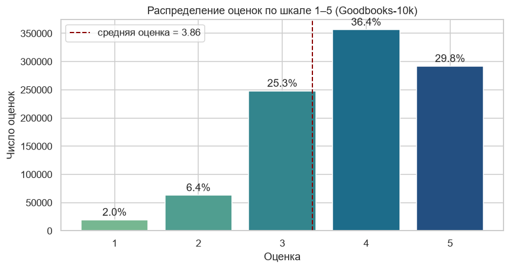
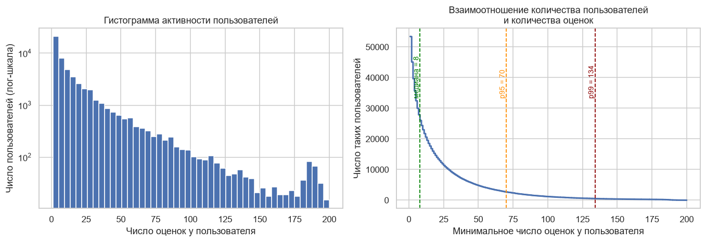
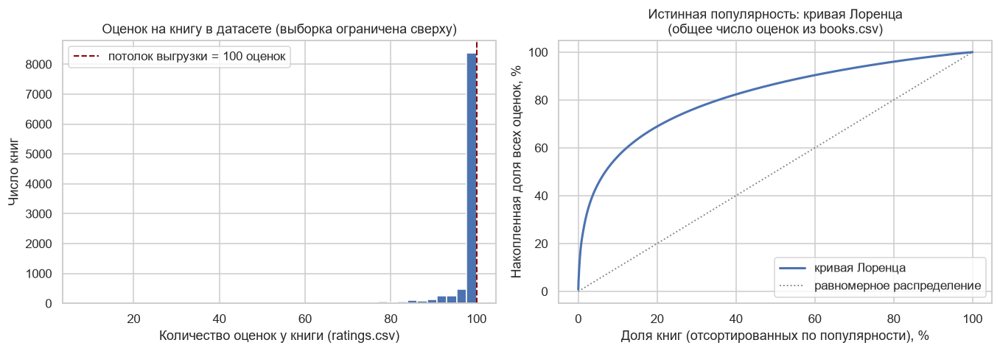
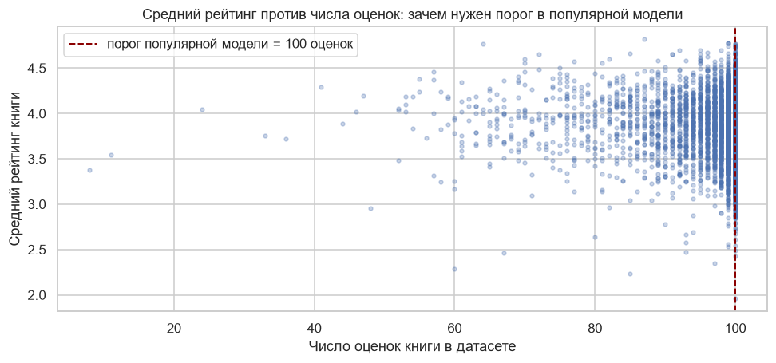
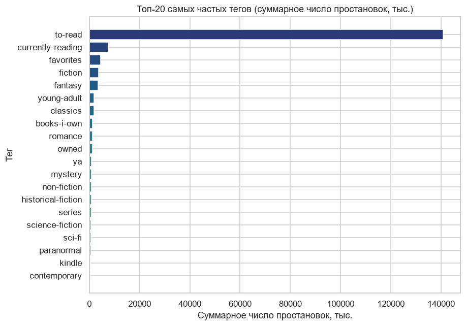
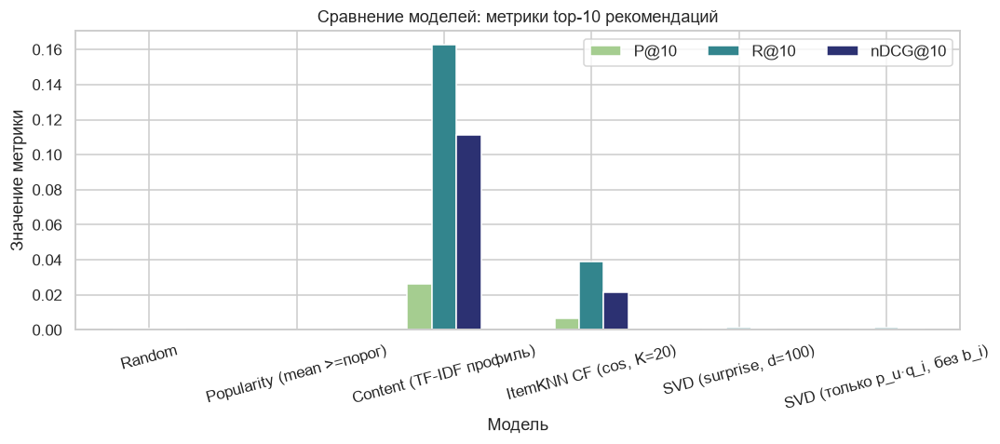
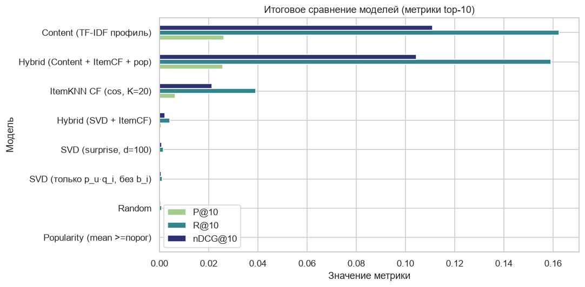

# Рекомендательная система книг (Goodbooks-10k)
## Данные

Датасет Goodbooks-10k. Файлы нужно положить в каталог `data/`:

| Файл          | Содержимое                                                        |
|---------------|-------------------------------------------------------------------|
| `ratings.csv` | Оценки пользователей (user_id, book_id, rating)                    |
| `books.csv`   | Метаданные книг: названия, авторы, средние рейтинги, счётчики      |
| `tags.csv`    | Словарь тегов                                                      |
| `book_tags.csv`| Привязка тегов к книгам с числом простановок                      |

## Установка и запуск

```bash
python -m venv .venv
source .venv/bin/activate        # Windows: .venv\Scripts\activate
pip install -r requirements.txt

dvc repro                        # полный запуск всех стадий
dvc metrics show                 # таблицы метрик
dvc plots show                   # графики
dvc params show                  # параметры запуска
dvc dag                          # граф стадий
```

Отдельную стадию можно пересчитать точечно: `dvc repro svd`.


```bash
black src
```

## Структура стадий

```text
eda -> split -> base_models -> itemcf -> svd -> evaluate -> hybrid_cold
```

| Стадия        | Скрипт                       | Выходные артефакты                                   |
|---------------|------------------------------|------------------------------------------------------|
| `eda`         | `src/stage1_eda.py`          | графики и сводка EDA                                  |
| `split`       | `src/stage2_split.py`        | train/test, индексные отображения                     |
| `base_models` | `src/stage3_base_models.py`  | популярная и контентная модели                        |
| `itemcf`      | `src/stage4_itemcf.py`       | матрица взаимодействий, близости, средние рейтинги    |
| `svd`         | `src/stage5_svd.py`          | факторы SVD, таблица RMSE                             |
| `evaluate`    | `src/stage6_evaluate.py`     | рекомендации и метрики ранжирования                   |
| `hybrid_cold` | `src/stage7_hybrid_cold.py`  | гибриды, холодный старт, итоговые таблицы             |

## Этап 1. Разведочный анализ

После удаления дубликатов пар пользователь-книга: 979 478 оценок, 53 424 пользователя,
10 000 книг, 34 252 тега и 999 912 записей book_tags.

### 1.1. Распределение оценок



Оценки сдвинуты к высоким значениям: средняя 3.856, медиана 4.0, на 4 и 5 приходится
66.2% оценок, на 1 и 2 — только 8.4%. Люди оценивают книги, которые сами выбрали и
дочитали. Отсюда два следствия: порог релевантности >= 4 обоснован, а сравнивать модели
только по RMSE некорректно — наивный прогноз «всем 3.9» уже даёт неплохую ошибку.
Нужны ранжирующие метрики.

### 1.2. Активность пользователей



Медианный пользователь поставил 8 оценок, топ-1% активных — от 134 (максимум в выгрузке
200). Почти 40% пользователей имеют меньше 6 оценок, поэтому холодный старт здесь не
гипотетическая проблема, а обычное состояние данных.

### 1.3. Популярность книг



В самом `ratings.csv` распределение почти равномерное: 6248 книг из 10000 набрали ровно
по 100 оценок, потому что выгрузка обрезана сверху. Настоящая популярность видна в
`work_ratings_count`: топ-1% книг собирает 22.8% всех оценок, топ-10% — 56.4%,
медиана около 24 тысяч, максимум почти 5 миллионов.

Топ-10 книг по общему числу оценок — [artifacts/tables/top10_popular_books.csv](artifacts/tables/top10_popular_books.csv):

| Книга                                                        | Оценок всего | В датасете |
|--------------------------------------------------------------|--------------|------------|
| The Hunger Games (The Hunger Games, #1)                      | 4 942 365    | 100        |
| Harry Potter and the Sorcerer's Stone (Harry Potter, #1)     | 4 800 065    | 100        |
| Twilight (Twilight, #1)                                      | 3 916 824    | 100        |
| To Kill a Mockingbird                                        | 3 340 896    | 100        |
| The Great Gatsby                                             | 2 773 745    | 100        |
| The Fault in Our Stars                                       | 2 478 609    | 100        |
| Divergent (Divergent, #1)                                    | 2 216 814    | 99         |
| The Hobbit                                                   | 2 196 809    | 100        |
| Pride and Prejudice                                          | 2 191 465    | 100        |
| The Catcher in the Rye                                       | 2 120 637    | 100        |

### 1.4. Зачем нужен порог в популярной модели



Средний рейтинг, посчитанный по малому числу оценок, крайне неустойчив. Примеры ловушек
без порога — [artifacts/tables/trap_low_counts.csv](artifacts/tables/trap_low_counts.csv):

| Книга                                     | Оценок | Средний рейтинг |
|-------------------------------------------|--------|-----------------|
| ESV Study Bible                           | 87     | 4.82            |
| The Divan                                 | 64     | 4.77            |
| The Holy Bible: English Standard Version  | 85     | 4.66            |
| One Piece, Volume 38: Rocketman!!         | 72     | 4.65            |
| This is Not My Hat                        | 70     | 4.60            |

### 1.5. Теги



Самые частые теги — служебные (`to-read`, `favorites`, `owned`), дальше идут жанровые:
`romance`, `fiction`, `fantasy`, `young-adult`. Служебные полки дальше удаляются: они
говорят о поведении читателя, а не о содержании книги. Всего 31 520 уникальных тегов,
в среднем 95 тегов на книгу — теги довольно шумные.

### 1.6. Разреженность матрицы

Матрица пользователь × книга: 53 424 × 10 000 = 534 240 000 ячеек, заполнено 979 478
(плотность 0.183%). Полная плотная матрица заняла бы 2.0 ГБ. Все сводные числа — в
[artifacts/tables/eda_summary.json](artifacts/tables/eda_summary.json).

Итоговые проблемы данных:

1. Разреженность: у большинства пар книг нет ни одного общего оценщика.
2. Смещение популярности: без персонализации 90% каталога остаются без трафика.
3. Смещение к высоким оценкам: негативного сигнала почти нет.
4. Холодный старт: 39% пользователей имеют меньше 6 оценок.
5. Нет временных меток: кросс-валидация по времени невозможна, используется случайный сплит.
6. Шумные теги и дубликаты пар.

## Этап 2. Разделение train/test

Holdout по 2 оценки делается только у пользователей с >= 6 оценками (у них в train
остаётся хотя бы 4), остальные целиком остаются в train и в метриках не участвуют.
Из рекомендаций исключаются уже прочитанные пользователем книги.

| Показатель                                | Значение      |
|-------------------------------------------|---------------|
| train                                     | 914 600 оценок |
| test                                      | 64 878 оценок (6.6%) |
| Пользователей в тесте (с >= 6 оценками)   | 32 439 из 53 424 |
| Пользователей без единой train-оценки     | 0             |
| Пользователей с < 5 train-оценками        | 20 225 (37.9%) |
| Книг без train-оценок                     | 0             |

Полная сводка — [artifacts/tables/split_summary.json](artifacts/tables/split_summary.json).

## Этап 3. Базовые и контентные модели

### Популярная модель

Скор книги равен среднему рейтингу в train при числе оценок >= 100, иначе книга не
проходит. Порог в выборке проходит 257 книг из 10000. Топ выдачи —
[artifacts/tables/popular_top10_train.csv](artifacts/tables/popular_top10_train.csv):
Гарри Поттер (бокс-сет, 4.45), Игра престолов (4.42), Марсианин (4.32) и другие книги,
которые почти все уже прочитали. Персонализации здесь нет, но модель закрывает холодный
старт.

### Контентная модель (TF-IDF)

Для каждой книги собирается текстовый профиль: слова из `original_title` (или `title`)
плюс теги без служебных полок. Профили векторизуются TF-IDF (min_df=3, sublinear_tf,
L2-нормировка), похожесть книг — косинус профилей. Профиль пользователя — нормированная
сумма профилей его любимых книг (оценки >= 4).

Примеры похожих книг — [artifacts/tables/similar_books_demo.csv](artifacts/tables/similar_books_demo.csv):
у «Голодных игр» находятся другие части трилогии и сопутствующие книги, у «Хоббита» —
другие произведения Толкина, у «1984» — антиутопии. Модель работает даже для книг без
единой оценки: достаточно названия и тегов. Минусы — склонность клонировать знакомое
(серии, авторы) и шумные синонимичные теги (`sci-fi` / `science-fiction`, `ya` / `young-adult`).

## Этап 4. Коллаборативная фильтрация: Item-Based CF

Близости книг считаются через произведение разреженных матриц со сжатием.
Стоимость пропорциональна числу фактических сооценок. В каждой строке
оставляется только топ-20 соседей: полная матрица близостей для 10 000 книг заняла бы
сотни мегабайт, а для 100 000 книг — десятки гигабайт.

Итог: `R_train` 53 424 × 10 000 с плотностью 0.171%, `S_topk` с 200 000 ненулевых
элементов. Прогноз для пары (пользователь, книга) — взвешенное среднее оценок
пользователя по соседям книги, при отсутствии пересечений — средний рейтинг книги.
Примеры прогнозов — [artifacts/tables/itemcf_demo.csv](artifacts/tables/itemcf_demo.csv).

Пути масштабирования: приближённый поиск соседей (LSH, HNSW, FAISS), снижение
размерности эмбеддингов до расчёта близостей, блочные и распределённые вычисления,
инкрементальные обновления и кэширование топ-K списков.

## Этап 5. Матричное разложение: SVD

Обучается `surprise.SVD` со 100 факторами за 20 эпох (около 12 секунд на всём train).
Параметры раскладываются в массивы по сквозным индексам и сохраняются в
`artifacts/models/svd_bundle.npz`.

Качество предсказания оценок — [artifacts/tables/rmse_table.csv](artifacts/tables/rmse_table.csv):

| Модель                  | RMSE   | MAE    |
|-------------------------|--------|--------|
| SVD (surprise, d=100)   | 0.8478 | 0.6688 |
| User mean               | 0.8871 | 0.6848 |
| ItemKNN CF (cos, K=20)  | 0.9016 | 0.6421 |
| Item mean               | 0.9387 | 0.7545 |
| Global mean             | 0.9806 | 0.7848 |

SVD лучше всех предсказывает значение оценки, но это ещё не значит, что она лучше
ранжирует кандидатов — проверка на этапе 6.

## Этап 6. Метрики ранжирования

Для каждого пользователя берутся его скрытые тестовые книги с оценкой >= 4 (релевантные),
модель строит топ-10 по скорингу без уже прочитанных книг, затем усредняются:

- **Precision@K** — доля релевантных книг среди K рекомендованных;
- **Recall@K** — доля найденных релевантных книг от всех релевантных пользователя;
- **nDCG@K** — то же с учётом позиции: попадание на верхних позициях ценнее.

Результаты — [artifacts/tables/metrics_main.csv](artifacts/tables/metrics_main.csv):

| Модель                          | P@5    | R@5    | nDCG@5 | P@10   | R@10   | nDCG@10 |
|---------------------------------|--------|--------|--------|--------|--------|---------|
| Random                          | 0.0002 | 0.0005 | 0.0003 | 0.0002 | 0.0010 | 0.0005  |
| Popularity (mean >=порог)       | 0.0000 | 0.0000 | 0.0000 | 0.0000 | 0.0000 | 0.0000  |
| Content (TF-IDF профиль)        | 0.0387 | 0.1203 | 0.0957 | 0.0261 | 0.1626 | 0.1111  |
| ItemKNN CF (cos, K=20)          | 0.0071 | 0.0215 | 0.0150 | 0.0064 | 0.0391 | 0.0214  |
| SVD (surprise, d=100)           | 0.0003 | 0.0009 | 0.0006 | 0.0003 | 0.0015 | 0.0009  |
| SVD (только p_u·q_i, без b_i)   | 0.0002 | 0.0005 | 0.0004 | 0.0002 | 0.0012 | 0.0006  |



Наблюдения:

1. **Рандом почти нулевой**: из 10 000 кандидатов нужно угадать конкретные скрытые книги.
2. **Модель на основе популярности даёт нули**: все её кандидаты — книги, которые активные
   пользователи уже прочитали, и они исключены из выдачи.
3. **Контентная модель лучшая**: скрытые книги пользователей логически связаны с их
   историей (продолжения серий, те же авторы и жанры), и TF-IDF по тегам ловит эту связь.
4. **ItemCF работает, но хуже**: при медиане 8 оценок на пользователя у пар книг редко
   хватает общих оценщиков, коллаборативный сигнал слабый.
5. **SVD в топ-N падает до случайного уровня**: при ранжировании по абсолютному прогнозу
   разброс оценок у книг заглушает персональную часть и всем достаётся один и тот же
   глобальный топ. По RMSE SVD лучшая, по ранжированию — нет.

## Этап 7. Гибрид и холодный старт

Гибридный скоринг: `0.5 * z(s_a) + 0.45 * z(s_b) + 0.05 * z(log1p(n_i))`, где z —
нормировка по кандидатам одного пользователя; без неё скоры разных моделей с разными
масштабами складывать нельзя.

Итоговая таблица — [artifacts/tables/metrics_full.csv](artifacts/tables/metrics_full.csv):

| Модель                          | P@10   | R@10   | nDCG@10 |
|---------------------------------|--------|--------|---------|
| Content (TF-IDF профиль)        | 0.0261 | 0.1626 | 0.1111  |
| Hybrid (Content + ItemCF + pop) | 0.0258 | 0.1592 | 0.1045  |
| ItemKNN CF (cos, K=20)          | 0.0064 | 0.0391 | 0.0214  |
| Hybrid (SVD + ItemCF)           | 0.0007 | 0.0042 | 0.0023  |
| SVD (surprise, d=100)           | 0.0003 | 0.0015 | 0.0009  |



Гибрид на тёплых пользователях чистую контентную модель не обогнал (0.1045 против
0.1111): примесь более слабого CF-сигнала слегка разбавляет контентный. Зато ценность
гибрида — в деградации: он не падает при холодном старте, а переключается на лучшую
доступную компоненту.

### Эксперимент: холодный старт

У 4000 случайно выбранных пользователей в истории оставлено не более 3 оценок, все
модели переобучены на урезанных данных. Результаты —
[artifacts/tables/metrics_cold.csv](artifacts/tables/metrics_cold.csv):

| Модель                  | P@5    | R@5    | nDCG@5 | P@10   | R@10   | nDCG@10 |
|-------------------------|--------|--------|--------|--------|--------|---------|
| Content (1-3 книги)     | 0.0250 | 0.0784 | 0.0596 | 0.0175 | 0.1087 | 0.0706  |
| Hybrid (content + pop)  | 0.0250 | 0.0784 | 0.0596 | 0.0175 | 0.1087 | 0.0706  |
| ItemKNN CF              | 0.0076 | 0.0230 | 0.0156 | 0.0065 | 0.0398 | 0.0217  |
| SVD (переобучена)       | 0.0005 | 0.0019 | 0.0009 | 0.0002 | 0.0019 | 0.0009  |
| Popularity              | 0.0000 | 0.0000 | 0.0000 | 0.0000 | 0.0000 | 0.0000  |

Контентной модели хватает одной-двух любимых книг, чтобы построить осмысленный профиль:
nDCG@10 проседает с 0.111 до 0.071, тогда как коллаборативные модели на урезанных
историях почти бесполезны. Гибрид удерживает качество лучшей доступной
компоненты: есть контентный сигнал — решает он, при полном холоде в дело вступает
популярная выдача.

## Выводы

1. По ранжированию выигрывает контентная модель на TF-IDF (nDCG@10 ~ 0.11), далее
   ItemCF (~ 0.02), SVD в топ-N почти не работает.
2. По предсказанию оценок лучшая SVD (RMSE 0.85 против 0.90 у ItemKNN): модель,
   обученная на регрессию оценки, не обязана хорошо ранжировать кандидатов.
3. Гибрид не обгоняет лучшую компоненту на тёплых пользователях, но обеспечивает
   устойчивость при холодном старте — компоненты гибрида важнее их весов.
4. Популярная модель нужна не для качества, а как запасной контур: новый пользователь,
   новая книга без оценок, деградация персонализации.

## Направления развития

- Обучить модель под ранжирование, а не под регрессию оценок: BPR или ALS из
  библиотеки `implicit` на неявном фидбеке.
- Для SVD исключить книжные смещения из скоринга кандидатов или использовать
  ранжирующий лосс.
- Заменить TF-IDF на эмбеддинги: Word2Vec по тегам или BERT по описаниям книг —
  это снимет синонимию и добавит семантики.
- Добавить признаки пользователей (жанровые предпочтения, средняя оценка, активность)
  и обучить бустинг-ранкер поверх скоров моделей.
- Нейросетевые подходы (two-tower, NCF): контентные признаки айтемов заодно лечат
  холодный старт книг.
- В выдачу добавить реранкинг на разнообразие и новизну, чтобы пробивать длинный
  хвост каталога; финальные решения проверять A/B-тестами, а не только офлайн-метриками.
``

## Порядок запуска

1. Положить файлы датасета в `data/`.
2. `pip install -r requirements.txt`.
3. `dvc repro` — пайплайн последовательно выполнит стадии, создаст `dvc.lock` и заполнит `artifacts/`.
4. Проверить метрики: `dvc metrics show`, графики: `dvc plots show`.
5. Перед коммитом прогнать форматирование: `black src`.